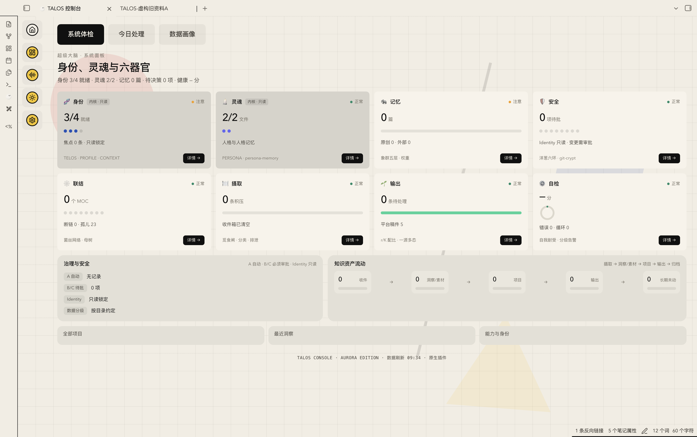
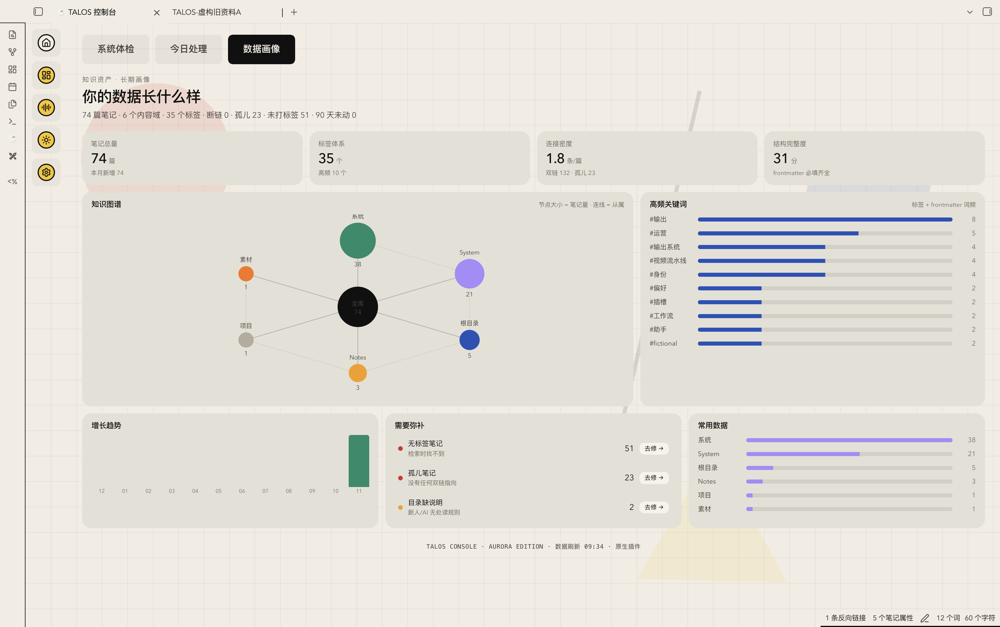
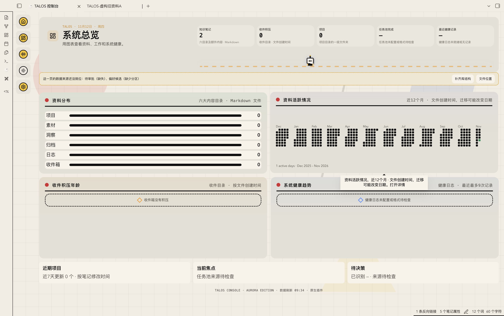
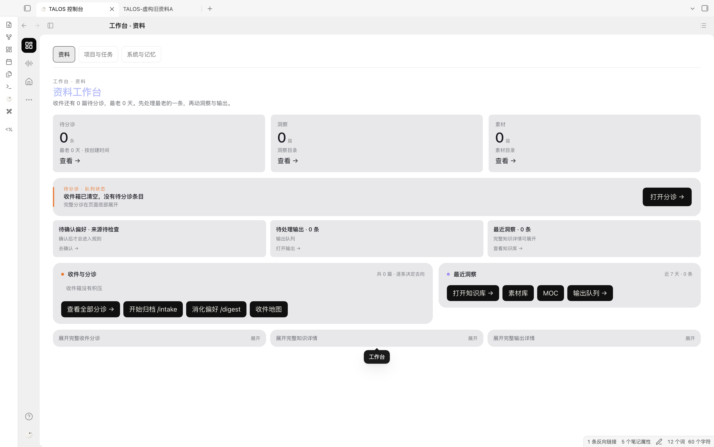
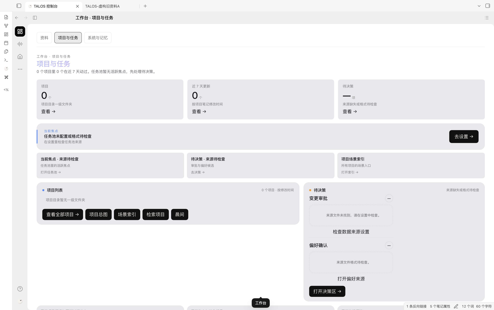
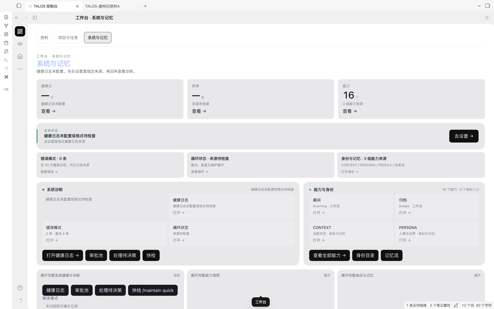

# TALOS 超级大脑

TALOS 超级大脑是一套面向个人知识管理的资料库框架，包含 Obsidian 控制台与本地资料整理工具。本仓库用于发布部署测试包。

**当前版本：candidate.21 八插件测试版。** [下载部署包](https://github.com/Hanhan758/talos-superbrain-releases/releases/download/v0.4.0-candidate.21-dist.1/talos-superbrain-candidate21-eight-plugins.zip) · [版本说明与校验文件](https://github.com/Hanhan758/talos-superbrain-releases/releases/tag/v0.4.0-candidate.21-dist.1) · [新建资料库](#方式一新建空白资料库) · [接入已有资料库](#方式二接入已有资料库) · [首次使用](#首次打开与使用)



*系统体检：使用虚构资料的实际界面。*

## 开始之前

1. 准备一台 Mac，并安装 [Obsidian 桌面版](https://obsidian.md/download)。本包的安装脚本需要 **Python 3.9 或更新版本**；在“终端”输入 `python3 --version` 查看。如果没有可用的 Python，可从 [Python 官网](https://www.python.org/downloads/macos/)安装；安装后重新打开终端并再次检查。没有 Codex、Claude 或 API 密钥，也可以先建库和使用本地检索。
2. 下载上面的 ZIP。请选择 `talos-superbrain-candidate21-eight-plugins.zip`，不要选择 GitHub 自动生成的 `Source code`。
3. 双击 ZIP，保留解压后的整个 `talos-superbrain-0.4.0-candidate.21` 文件夹，不要只复制里面可见的几个文件：它也包含 `.agents`、`.claude`、`.obsidian` 等隐藏目录。**解压后的文件夹是安装源，新建出来的文件夹才是日常使用的资料库。**
4. 如果要接入已有资料，先保存并关闭旧库中的文档，再用 Finder 完整复制一份旧库作备份，包含隐藏的 `.obsidian`、附件和其他原文件。选择一个**尚不存在**、不在旧库或安装源里面的新目录作为目标；不要覆盖旧库。

可选：在“终端”核对下载文件的 SHA-256。下面假设文件仍在“下载”目录；如果保存到了其他地方，请改为实际路径。

```sh
shasum -a 256 "$HOME/Downloads/talos-superbrain-candidate21-eight-plugins.zip"
```

结果应以 `ec6ff91b3dd4a348b47fe795e420cf6b68bad35bd4c906fd21f791b9f507aa6d` 开头，也可与 Release 中的 `SHA256SUMS.txt` 对照。

### 选择安装方式

- **图形引导**：双击解压目录里的 `启动超级大脑.command`，按提示选择新建或接入。当前测试版的真实双击流程尚未单独验收；它会显示预览，确认后才写入。
- **终端手动安装**：下面提供了逐步预览和执行命令。原九插件候选的这些核心流程在虚构库中验证过；八插件版已完成合成安装和健康检查，但尚未单独完成 Obsidian GUI 验收。

如果 macOS 阻止打开启动器，请先核对下载来源和文件完整性，再参考 [Apple 的安全打开说明](https://support.apple.com/zh-cn/102445)；也可以使用下方手动方式。不要关闭系统的全局安全保护。

## 方式一：新建空白资料库

### 使用启动器

1. 在解压后的安装源中双击 `启动超级大脑.command`。它会检查 Python、Obsidian 和可用的智能体；没有 Codex 或 Claude 也可以继续建库。
2. 看到“已有笔记库吗？”时，**直接回车**，选择新建空白库。
3. 默认目标是 `文稿/我的超级大脑`。可以回车接受默认位置，也可以将一个已有的普通文件夹拖进终端，启动器会尝试在它里面创建 `我的超级大脑` 子目录。**如果所选位置已经是一个已安装的超级大脑库，启动器可能直接打开它，而不会新建库。**请核对屏幕显示的目标位置。
4. 阅读预览：确认新库路径和文件范围。按回车开始；输入 `n` 后回车取消。完成后，启动器会检查资料库并请求 Obsidian 打开；如未自动打开，请按[首次打开与使用](#首次打开与使用)手动选择新库。

### 使用终端手动新建

以下假设 ZIP 解压到了“下载”目录，并希望把新库建在“文稿”目录。先打开“终端”，逐行运行；如果解压或目标位置不同，请先修改对应路径。

```sh
TALOS_PACKAGE="$HOME/Downloads/talos-superbrain-0.4.0-candidate.21"
TALOS_NEW="$HOME/Documents/TALOS-新资料库"
python3 -B "$TALOS_PACKAGE/System/tools/deploy.py" install --source "$TALOS_PACKAGE" --target "$TALOS_NEW"
```

这是**预览**，不创建资料库。确认输出中 `status` 为 `ready`、`written` 为 `false`，并核对命令中的 `TALOS_NEW` 是你选定的、尚不存在的新目录。预览 JSON 不显示目标路径。若显示 `already-installed`，说明该位置已有安装，不是新建成功；请换一个目标目录。

确认无误后，在**同一个终端窗口**执行相同命令并加上 `--apply`：

```sh
python3 -B "$TALOS_PACKAGE/System/tools/deploy.py" install --source "$TALOS_PACKAGE" --target "$TALOS_NEW" --apply
```

运行结束后，新库示例位置为 `文稿/TALOS-新资料库`。把它作为 Obsidian 仓库打开，**不要把解压后的安装源当作新库**。

## 方式二：接入已有资料库

普通 Obsidian 仓库或 Markdown 文件夹可以复制接入新目录。操作前请确认已有完整备份；旧库保留在原位置，接入后的整理发生在新库中。

### 选择目录处理方式

| 方式 | 启动器选项 | 结果 |
| --- | --- | --- |
| `map` | 1，默认 | 能识别的常见目录并入对应模块，未识别的目录保留；之后核对映射和相对链接。 |
| `keep` | 2 | 尽量保留旧目录名，冲突时可能改名；适合先保持原结构再慢慢整理。 |
| `inbox` | 3 | 旧资料先进入收件箱中的旧库目录，之后分批整理。 |

### 使用启动器接入

1. 双击安装源里的 `启动超级大脑.command`。当询问“已有笔记库吗？”时，将**旧库文件夹**拖入终端，回车。
2. 输入 `1`、`2` 或 `3` 选择上面的处理方式。再选择一个新库位置；不要选择旧库本身或旧库内部。
3. 核对预览中的新位置、笔记数量、目录映射、待整理事项和跳过项。确认后回车执行；输入 `n` 可取消。
4. 复制后，启动器可能询问是否补充缺少的标题、日期、标签或状态：**回车会修改新库副本中的字段**；输入 `n` 可跳过。旧库不因此改写。
5. 在新库的 `System/working-memory/reports/adopt.json` 查看接入报告，抽查笔记、附件、相对链接、主题和快捷键。同名旧插件会归档；其他旧插件及配置按报告处理。接入只是复制和映射，不代表资料已自动分类或查重。

### 使用终端手动接入普通旧库

先按[手动新建](#使用终端手动新建)中的方式设置 `TALOS_PACKAGE`。先运行下面两行；出现提示后，输入旧库的**完整路径**并回车。可在 Finder 中按住 Option 右键旧库，选择“拷贝为路径名称”，然后粘贴到终端。路径中有空格也可以。

```sh
printf '请输入旧库的完整路径：'
IFS= read -r TALOS_OLD
```

再运行下面两行，设置新库位置并预览：

```sh
TALOS_NEW="$HOME/Documents/TALOS-接入资料库"
python3 -B "$TALOS_PACKAGE/System/tools/deploy.py" adopt --source "$TALOS_PACKAGE" --from-vault "$TALOS_OLD" --target "$TALOS_NEW" --layout keep
```

这里用 `keep` 演示；可在预览**和执行命令中同时**替换为 `map` 或 `inbox`。确认 `written: false`、目标、目录映射和跳过项后，在同一个终端窗口执行：

```sh
python3 -B "$TALOS_PACKAGE/System/tools/deploy.py" adopt --source "$TALOS_PACKAGE" --from-vault "$TALOS_OLD" --target "$TALOS_NEW" --layout keep --apply
```

`TALOS_NEW` 示例位置必须尚不存在；如需换位置，请在运行预览前修改变量。符号链接可能被跳过，具体以预览和接入报告为准。旧版 Standard 的 `TALOS中枢/`、`.talos/` 等系统资料默认留在旧库，不会自动继承权限或记忆状态。

### 已有超级大脑框架资料库

由本框架安装、包含 `System/.install-manifest.json` 或 `System/release.json` 的旧超级大脑库应使用 `migrate`；旧库根目录还须有 `AGENTS.md`。先备份，并选择全新的目标目录。仅安装过 TALOS 插件的普通 Obsidian 库仍可按普通旧库使用 `adopt`。先设置上面的 `TALOS_PACKAGE`、`TALOS_OLD` 和 `TALOS_NEW`，再预览：

```sh
python3 -B "$TALOS_PACKAGE/System/tools/deploy.py" migrate --source "$TALOS_PACKAGE" --from-vault "$TALOS_OLD" --target "$TALOS_NEW"
```

核对预览后，使用相同参数加 `--apply` 执行；完成后先检查新库，确认无误再切换使用。

```sh
python3 -B "$TALOS_PACKAGE/System/tools/deploy.py" migrate --source "$TALOS_PACKAGE" --from-vault "$TALOS_OLD" --target "$TALOS_NEW" --apply
```

**同版本注意：**原九插件候选和本八插件分发包都显示 `candidate.21`。启动器遇到同版本 TALOS 库会直接打开它，不能视为自动升级或切换到八插件版。同版本迁移请使用新目标、保留完整旧库并逐项核对；该变体的此场景尚未单独完成 GUI 验收。

## 首次打开与使用

1. 在 Obsidian 的仓库选择界面选择“打开本地仓库”或“打开文件夹为仓库”，选中**刚建成的新库文件夹**。
2. 首次打开时，按 Obsidian 提示确认是否信任仓库作者并启用第三方插件。需要时到“设置 → 社区插件”检查受限模式及 TALOS 的启用状态；只对你信任的来源启用插件。参见 [Obsidian 社区插件说明](https://help.obsidian.md/community-plugins)。
3. 点击侧边栏的 TALOS 图标（提示为“打开 TALOS 控制台”），或打开命令面板搜索 **`TALOS: Open console`**。个人控制台默认提供首页、工作台、语音助手、系统总览和设置。身份、偏好和模型可以之后再配置。
4. 本包内置 **TALOS 和八个第三方插件**；**Excalidraw 未内置**，可自行决定是否从 Obsidian 社区插件安装。包内旧版 `START-HERE.md` 的插件列表仍提到 Excalidraw，请以本页与包内 `DISTRIBUTION.md` 为准。

### 第一次做一个本地检索

1. 在 Obsidian 的文件列表中右键新库的 `素材/` 文件夹，选择新建笔记；在正文写入一个独特词语，例如 `我的第一条测试资料`。
2. 打开 Obsidian 命令面板，选择 **`TALOS: 打开资料与检索`**，再进入 **C03 知识检索**。
3. 在“本地工具”里先预览并按界面提示更新索引；在“检索候选”输入刚写的词并预览。
4. 点击命中结果，打开原文核对。默认检索范围不包含收件箱；待整理的收件资料需要先归类或按实际配置调整范围。

本地资料统计、索引和检索不要求先连接模型。Codex／Claude 工作流需要你自行安装、登录并按宿主提示授权；模型 API 与百炼语音需要分别配置。语音开启后会将音频发送到所选服务地域，具体费用与权限以服务配置为准；截图中麦克风关闭不代表语音已配置。不要把密钥写进普通 Markdown 笔记。

如果已经配置好自己的智能体，可以从一件小事开始，例如：“请先读取 `AGENTS.md`、`START-HERE.md` 和 `System/ONBOARDING.md`，在当前新库内做只读盘点，说明我的资料放在哪里，再帮我检索一条资料；修改文件前先展示计划。”核对原文和结果后，再决定是否继续整理。

## 常见问题与回退

- **找不到 TALOS**：确认打开的是安装后的新库，而不是解压源；检查 Obsidian 社区插件的受限模式及 TALOS 是否启用。
- **知识数量不对或检索不到旧笔记**：先确认旧笔记确实复制到新库，核对 `System/config.json` 和 TALOS 的库与数据设置；预览并更新索引，再用原文中的独特词检索。统计页面和全库盘点的范围可能不同。
- **健康分、任务池或模型显示未配置**：这些项目需要对应来源或服务；显示空态不自动等于安装失败。可先运行下面的本地检查：

  ```sh
  python3 -B "$TALOS_NEW/System/tools/deploy.py" doctor --root "$TALOS_NEW"
  ```

  在先前设置过 `TALOS_NEW` 的同一个终端窗口中运行；如已关闭终端，请先按上文重新设置它。此命令检查文件和结构，不代表 Obsidian 插件、模型或语音已经启用。只有需要检查本机智能体时，才额外添加 `--host codex` 或 `--host claude`。
- **预览失败或目标已存在**：停止执行，检查路径是否拼写正确，改用尚不存在的新目标。不要删除或覆盖旧库来消除提示。
- **新库不符合预期**：在 Obsidian 中重新打开保留的旧库或完整备份。内容快照不包含完整 `.obsidian` 配置，不能代替完整资料库备份。

## 真实界面截图

以下是 Obsidian 中使用虚构测试资料的实际截图，展示不同页面和界面主题。截图用于展示界面；八插件分发版尚未单独完成 GUI 验收。

| 数据画像 | 系统总览 |
| --- | --- |
|  |  |

| 语音助手 | 资料工作台 |
| --- | --- |
|  |  |

| 项目与任务 | 系统与记忆 |
| --- | --- |
|  |  |

## 测试范围

原 candidate.21 九插件候选曾在 macOS、Obsidian 1.15.0 中以虚构资料验证新建库、接入库、笔记计数、本地检索和打开资料。八插件分发版保留原包其余程序文件，已通过合成安装和健康检查；其 Obsidian GUI、真实双击启动器、真人完整流程和其他平台尚未单独验收。逐像素一致亦尚未证实。

## 许可

TALOS 自有插件采用个人非商业源码可用许可；商业使用需要另行授权。该许可不是 OSI 批准的开源许可。第三方插件、字体、Emotion Ball 和其他组件遵循各自许可，详见部署包内的许可原文、声明和来源清单。
